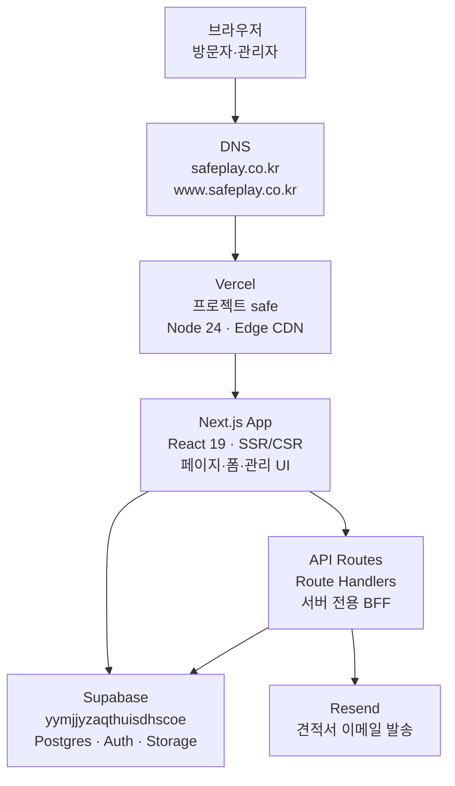

# safeplay.co.kr — 도메인 · 프론트 · 백엔드

KICON 본사 마케팅·문의·교육·리포트 사이트 · GitHub [koreatommy/safe](https://github.com/koreatommy/safe) · Vercel 프로젝트 **safe**

> Source: Vercel get_project · safe repo · 2026-09-01

| 항목 | 값 |
|------|-----|
| 공개 도메인 | 2 (루트 + www) |
| 프론트 프레임워크 | Next.js 16 |
| Supabase 프로젝트 | 1 |
| 서버 API Route | 4 |

---

## inspect와의 관계

`safeplay.co.kr` 본체는 **safe** 저장소입니다. 점검 SaaS 앱은 별도 서브도메인 **inspect.safeplay.co.kr** (inspect 저장소 · Supabase `hliykvfxldohkxnizxpy`)에서 운영되며, 디지털 명함 등에서 링크로만 연결됩니다.

---

## 요청 흐름 (프론트 → 백엔드)

- 화살표: HTTP / Supabase SDK 호출
- **Next.js App**: 프론트엔드 렌더링 계층 (App Router)

---

## 도메인

| URL | 역할 | 호스팅 |
|-----|------|--------|
| https://safeplay.co.kr | 프로덕션 루트 | Vercel · safe |
| https://www.safeplay.co.kr | www 별칭 | Vercel · safe |
| safe-ruby.vercel.app | Vercel 기본 도메인 | Vercel · safe |
| localhost:3000 | 로컬 개발 | `npm run dev` (safe repo) |

---

## 프론트엔드

| 레이어 | 기술 |
|--------|------|
| 프레임워크 | Next.js 16.1 · App Router |
| UI | React 19 · Tailwind CSS 4 |
| 애니메이션 | Framer Motion · Rive · Three.js |
| 차트 | Chart.js (게임 결과 등) |
| 렌더링 | SSR + Client Components 혼합 |

브라우저에서 Supabase anon key로 직접 INSERT/SELECT (문의·교육신청·게임). 관리자 화면은 비밀번호 헤더 + Supabase 클라이언트.

---

## 백엔드

| 서비스 | 역할 |
|--------|------|
| Next.js API Routes | 서버 전용 로직 (Vercel Serverless) |
| Supabase Postgres | 영속 데이터 · RLS |
| Supabase Storage | 증명서·문의 첨부 (`certificates` 버킷) |
| Resend | 관리자 견적서 이메일 발송 |

Supabase ref: **yymjjyzaqthuisdhscoe** — inspect 앱(`hliykvfxldohkxnizxpy`)과 **별도 DB**입니다.

---

## 주요 페이지 (프론트 라우트)

| 경로 | 기능 | 데이터 접근 |
|------|------|-------------|
| `/` | 랜딩 (Hero·요금 CTA·문의) | ContactForm → Supabase |
| `/price` | 요금제 HTML | 정적 HTML (`pricing.html`) |
| `/admin` | 관리자 대시보드 | Supabase + API Routes |
| `/admin/login` | 관리자 로그인 | `NEXT_PUBLIC_ADMIN_PASSWORD` |
| `/game` | 안전 퀴즈 게임 | Supabase `game` 스키마 |
| `/game/leaderboard` | 리더보드 | Realtime 구독 |
| `/info` | 정보 페이지 | 정적/클라이언트 |
| `/report/*` | 지자체 점검·위험성평가 리포트 | HTML/PDF Route Handlers |
| `/card/*` | 디지털 명함 | 정적 HTML + QR |
| `/inspect_tool` | 점검 도구 소개·주문 | product-orders API |

---

## API Routes (서버 백엔드)

| 엔드포인트 | 메서드 | 역할 |
|-----------|--------|------|
| `/api/inspect-tool/product-orders` | POST | 점검 도구 구매 신청 → Supabase INSERT |
| `/api/admin/inspect-tool-product-orders` | GET/PATCH | 주문 목록·상태 (service_role) |
| `/api/admin/send-quote` | POST | 견적서 PDF 이메일 → Resend |
| `/api/game/reset` | POST | 게임 데이터 초기화 (service_role) |

---

## Supabase 데이터 (`yymjjyzaqthuisdhscoe`)

### public 스키마

| 테이블 / 버킷 | 용도 |
|--------------|------|
| `safe_contact_inquiries` | 홈페이지 문의 |
| `safe_contact_inquiry_notes` | 문의 메모 |
| `safe_education_applications` | 교육 신청·수료증 |
| `safe_inspect_tool_product_orders` | 점검 도구 구매 신청 |
| `certificates` (Storage) | 수료증 PDF 업로드 |

### game 스키마

| 테이블 | 용도 |
|--------|------|
| `participants` | 퀴즈 참가자 |
| `results` | 점수·순위 |
| `answers` | 문항별 답변 |

---

## 환경 변수 (Vercel Production)

- `NEXT_PUBLIC_SUPABASE_URL`
- `NEXT_PUBLIC_SUPABASE_ANON_KEY`
- `SUPABASE_SERVICE_ROLE_KEY`
- `NEXT_PUBLIC_ADMIN_PASSWORD`
- `RESEND_API_KEY`
- `RESEND_FROM_EMAIL`
- `COMPANY_*` (견적서 발신 정보)
